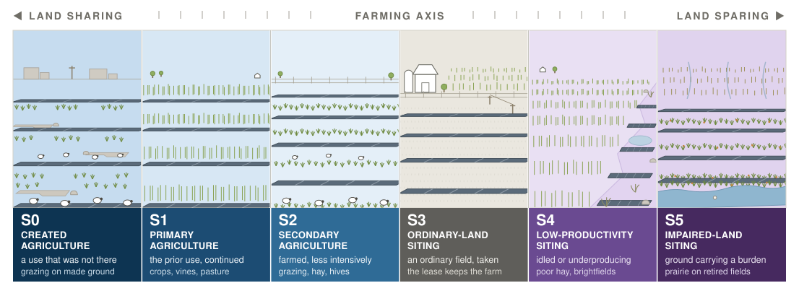

# The Farming Axis {#sec-farming-axis}

From the road, one array looks much like another. The differences are underneath it, and the farming axis asks about them with one question: **what happened to [agricultural production](terminology.qmd#term-agricultural-production) on this ground?** Five positions, S1 through S5, run from **land sharing**, where farming continues under the array, to **land sparing**, where the array's ground comes out of farming so that other ground can be left alone. A sixth, S0, sits beyond the sharing end, for ground that was never farmed before the array and is farmed under it. Scale says what was available. The position says what happened.

The axis is not a lever. It is what siting, structure, and management produce together. Much of the public argument about solar on farmland turns on whether the ground should stay in farming [@moore2022], and this axis gives that argument names. About 70% of the solar farms built in rural US areas through 2020 went onto agricultural land [@maguire2024]. What an array replaces depends on the region. In New York, a least-cost buildout would land mostly on pasture and hay, and steering it off farmland would put over 41,000 hectares of forest at risk [@gallaher2026], so the argument there is about grassland birds and woodland as much as row crops. A position means the same thing in every state. What the array displaced does not. The axis borrows its two poles from the land-sharing and land-sparing debate in conservation ecology [@green2005; @phalan2011], but unlike that debate it does not rank the positions against each other.

{#fig-farming-positions}

## The positions {#sec-positions}

@tbl-positions, at the end of the chapter, sets out each position: the ground beforehand, production afterward, the typical ground layer, and where the benefit lands.

The two halves of the axis are named differently on purpose. Where farming continues, the position is named for the farming that survives, and it is judged against what the ground carried before. Sheep on land that was already pasture are S1. The same flock on land that was growing corn is S2, because one use continued and the other became less intensive. Less intensive means fewer passes, inputs, and harvests in a year. It says nothing about whether the new use earns less. Where farming stops, the position is named for the ground the array took: ordinary, idle, or impaired. **A position records the ground and the farming, and nothing about who benefits.** S3 says only that ordinary productive ground came out of farming. Whether a lease keeps the farm business going, or the rent leaves with an owner who does not farm, is read on the restorative functions in Chapter 6. An S3 site that does no restorative work on any of them is a [bare conversion](terminology.qmd#term-bare-conversion), the baseline the lexicon reads other projects against.

S4 and S5 differ in where the benefit goes. S5 does its good on the ground it took and downstream of it, by ending a burden like nitrate running off a tile-drained field or a well pumping more than the aquifer can supply. S4 spares other land that the array did not take, so its benefit lands on ground the array never touched and can only be argued, not seen.

::: {.how-to}
**Placing a site.** Each site gets exactly one position, settled by two questions asked in order and two rules for what they leave open.

1. **Is a farm still taking something off this ground?** If the use is essentially the one the ground carried before, the site is **S1**. If a farm still works it, but less intensively, it is **S2**. If the ground carried no farming at all before the array, it is **S0**. Rent does not count, because it comes out of the contract, not the ground. Mowing does not count either, because nothing leaves.
2. **If nothing is taken, what was the ground before?** Ordinary productive land gives **S3**, ground already idle or chronically low-yielding gives **S4**, and ground carrying a measurable burden gives **S5**.

Ground that fits both S4 and S5, such as a wet corner that also leaks nitrate, is **S5**, because ending the burden is what the array does there. An array spread over more than one kind of ground takes the position of most of its footprint, with the rest noted beside it.
:::

Position follows the ground's history: a waterway newly seeded into a gullying swale is S5, and an old one still cut for hay is S1.

Asked across a whole landscape, those two questions sort arrays by the ground each one went onto. One stretch of farmland can hold every position at once, often more than one on the same farm (@fig-farming-landscape). The same positions turn up in every region on different ground: the dry corners of a pivot in an irrigated western valley (@fig-farming-landscape-west), an old field gone to brush in an eastern dairy valley (@fig-farming-landscape-east).

::: {.panel-tabset}

### Midwest

{#fig-farming-landscape}

### West

{#fig-farming-landscape-west}

### East

{#fig-farming-landscape-east}

:::

## Which positions each scale allows {#sec-wedge}

Farming carries on under panels at every size. At A1 it is the farmer's own yard, and at A5 it is a hired flock on ground that was already pasture. Sparing is what is scarce at the small end, because an acre or two spares almost nothing. The one combination that thins out toward the large end is S4, because a developer assembling one large block near a substation cannot collect scattered remnants of poor ground. S5 does not thin the same way, since a depleted aquifer covers a whole district. S0 has no size limit at all: a closed landfill grazed under a utility array is S0, and so is a pollinator garden kept with hives inside a small municipal array. Chapter 7 draws this form by form (@fig-archetype-map).

A position records a fact about the ground, not the quality of the project. A site can sit at S5 and still run gravel and herbicide under the panels for thirty years. What the ground goes on to do is the subject of Chapter 6.

::: {.callout-tip .running-example icon=false title="At Rabbit Hills"}
The ground was a non-irrigated sheep pasture before the array, and it is a sheep pasture under it, so the first question settles it: a farm still takes the same thing off the same ground. That is **S1**, primary agriculture, and it is the case this chapter uses to explain S1: sheep on land that was already pasture.
:::

## The six positions in detail {#sec-positions-detail}

::: {.position-table}
| Position | The ground beforehand | Production afterward | Typical ground layer | Where the benefit lands |
|---|---|---|---|---|
| **S0 — Created agriculture** | Developed, built, or otherwise carrying no agricultural use | Begins where there was none | Usually grazed | On the same ground, and on whoever farms it |
| **S1 — Primary agriculture** | The use it already carried | Continues essentially unchanged | The crop, the vines, or the pasture itself | On the same ground |
| **S2 — Secondary agriculture** | Usually cropland; any ground still farmed, but less intensively | Continues, as a less intensive use than before | Grazed, cut for forage or hay, or worked for hives | On the same ground, and on the farm working it |
| **S3 — Ordinary-land siting** | Ordinary productive ground | Stops inside the footprint | Whatever is maintained; often mown | On the farm business, if the lease keeps it going |
| **S4 — Low-productivity siting** | Already idle, marginal, or chronically low-yielding | Stops, where little or nothing was still produced | Often left to grow wild | On productive land elsewhere that went unbuilt |
| **S5 — Impaired-land siting** | Carrying a measurable off-site burden | Stops, and the burden stops with it | Perennial cover chosen against the burden | On the ground taken, and downstream of it |
: The six positions, and what changes across them. The first two columns settle the position and the last two say what follows from it. {#tbl-positions}
:::

**Go deeper:** the position entries [S0](terminology.qmd#term-s0) to [S5](terminology.qmd#term-s5) and the [feasible wedge](terminology.qmd#term-feasible-wedge) in the Terminology, including corn grown for ethanol as the large American S5 case · what [sparing](terminology.qmd#term-displaced-benefit) claims about the wider landscape · the [dual-use](terminology.qmd#term-dual-use) dispute.
