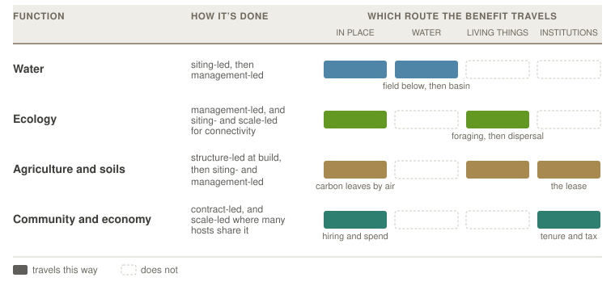

# Restorative Functions {#sec-functions}

Two solar farms in the same county: same size, same panels, same crop ground underneath. Under one, gravel and a herbicide schedule. Under the other, a planting rooted deep enough to hold a summer storm where it falls. Nothing about the land separates them. **Being [restorative](terminology.qmd#term-restorative) is not a property of a piece of ground. It is something a design produces.** The [restorative functions](terminology.qmd#term-restorative-function) are the four ways an array affects the landscape around it. They are where the levers' restorative work lands, and so the four things a design can aim at: water, ecology, agriculture and soils, and community and economy. Treat them as a palette rather than a scorecard, since no project delivers all four and some work against each other.

{#fig-functions-overview}

## Water {#sec-fn-hydrologic}

Water is what soaks in, what runs off, and what the runoff carries. Which of those an array can change depends on where the water comes from: where crops run on rain, the work is catching runoff, and where they run on a pump, it is cutting the pumping. Its quality can be improved two ways, and they need opposite ground. Avoided loading puts the array on the field that was leaking nutrients, so the fertilizer stops with the cropping. Interception puts perennial cover on the ground below that field, where it catches what is already moving. Prairie strips on a tenth to a fifth of a field, planted across the slope and at its foot, cut the soil washing off it by about 95% [@schulte2017], a result nobody has yet repeated beneath an array. Where solar replaces irrigated cropland, it can ease an aquifer, but only where rules keep the saved water from being pumped somewhere else. Kansas irrigators showed that metered, enforced limits can cut pumping [@zwickle2021].

## Ecology {#sec-fn-biodiversity}

Ecology is what can live on the ground and what can move through it. Habitat is built from the ground layer up. In a model of UK solar parks, managing the whole site as meadow supported about twice the foraging bumble bees and nests of turf with flowered margins [@blaydes2022]. [Connectivity](terminology.qmd#term-connectivity) belongs to the arrangement rather than to any one patch. A planting joined to a fencerow is part of a network, while the same seed mix fenced in the middle of row crops is an island. Across a landscape the arrangement is also a matter of scale. Many small arrays put more planted edge within reach of more fields than one large one does, though nobody has yet measured the difference (§-@sec-leads). Over 3,500 km² of pollinator-dependent US cropland lies within 1.5 km of existing and planned solar, the distance that analysis took as a pollinator's foraging range [@walston2018].

## Agriculture and soils {#sec-fn-agricultural}

This function asks what the array does *for* farming, which is a different question from the farming axis. A project that has stopped all farming inside its fence can still draw more bees to the crop next door [@walston2024], and can be the reason the host farm stays in business. It also asks what the soil becomes. Permanent cover can rebuild carbon and structure where tillage stops, though under arrays the gains measured so far are small [@krasner2025]. Grading strips the topsoil and heavy traffic compacts what is left, so a site can begin its thirty years in debt. Whether shade helps a crop depends on the climate: it relieves heat and drought in hot, dry places and costs yield in cool, humid ones (§-@sec-regionality). **A racking choice is a soil decision, made years before anyone picks a seed mix.**

## Community and economy {#sec-fn-community}

This is the one function not about the land. It asks what the people hosting the project get: lasting income and tax revenue, whether they can live alongside the array and had a real say in it, and whether the costs and the benefits land on the same people. "The community" is not one party. Landowners collect the lease, but a tenant farming that ground may not, and nearly 40% of Central Valley farmland is rented or leased [@stid2025]. Neighbors bear the view and the construction traffic, usually without a payment.

## Which route a benefit takes {#sec-benefit-range}

A function is produced in one place and received in another, and the useful question is which route it takes, not how far it goes. Some benefits stay **in place**, like soil carbon and moisture under the panels. Most leave along one of three networks: **water**, running downslope to the field below and the creek; **living things**, carrying pollination and pest control to fields within foraging range; and **institutions**, carrying leases, taxes, and subscriptions wherever ownership and contracts send them. Land sparing delivers nothing that moves at all, since its benefit is ground elsewhere that stayed as it was. The route decides who can check a claim and who receives the benefit.

## Stopping a harm and starting a benefit {#sec-harm-benefit}

Restoration covers two jobs. Stopping a harm ends something the ground was doing to somewhere else, such as nitrate leaving a tile line, and it can only be argued against the year that would otherwise have happened. Starting a benefit puts something on the ground that was not there, and anyone can drive out in July and see whether it took. The farming axis mostly records harm: what was given up, and by whom. **None of its positions says what the ground goes on to do**, which is why describing a project takes both readings.

## Reading the outcomes {#sec-scale}

Each function carries two outcomes, and those eight are what a project can be judged on.

::: {.function-table}
| Function | Outcomes |
|:--|:--|
| **Water** | quantity, meaning what soaks in and what leaves · quality, meaning what the water carries with it |
| **Ecology** | diversity, meaning what can live there · connectivity, meaning what can move through |
| **Agriculture and soils** | food production, meaning what the ground still grows · soil quality, meaning what it is made of |
| **Community and economy** | financial security, meaning durable local income · livability, meaning whether people can live alongside it and had a real say |
: The eight outcomes, two to a function. {#tbl-outcomes}
:::

Each outcome runs from causing harm at the center of the footprint to promoting benefit at the rim, through a ring where the project leaves that outcome no worse than it found it. **The middle ring is a zero point, not a pass mark.** A project that gains on one outcome and loses on another has a shape rather than a score, and an outcome that falls inside the ring is a commitment the design did not keep. **Every footprint in this lexicon is hypothetical for now.** Each is drawn from what a form is designed to do and from studies of similar sites, before any project has been measured this way, and each will be redrawn as monitored projects report.

{#fig-outcomes-footprint}

::: {.callout-tip .running-example icon=false title="At Rabbit Hills"}
Two studies measured what the array did. Corvallis gets little rain from July through September, so the shade did its work when water was scarcest. Where summers are wet, the same effect would likely matter less. Through that dry summer, the soil under the panels stayed wetter than the open pasture, the shaded ground grew 90% more late-season forage, and it used water 328% more efficiently [@adeh2018]. Across two spring grazing seasons, the pastures under the panels grew 38% less forage than the open ones, but of higher quality, and lambs grazing them gained 120 grams a day against 119 in the open. Growing lamb and power on the same ground was about twice as productive as splitting it between a pasture and a solar farm [@andrew2021]. Those results are for water and agriculture. Nobody has measured ecology or the community side at this site.
:::

**Go deeper:** the four function entries, from [water](terminology.qmd#term-fn-hydrologic) to [community and economy](terminology.qmd#term-fn-community), in the Terminology, including each recipient of the community function named separately · why [microclimate](terminology.qmd#term-microclimate) is a mechanism rather than a function.
